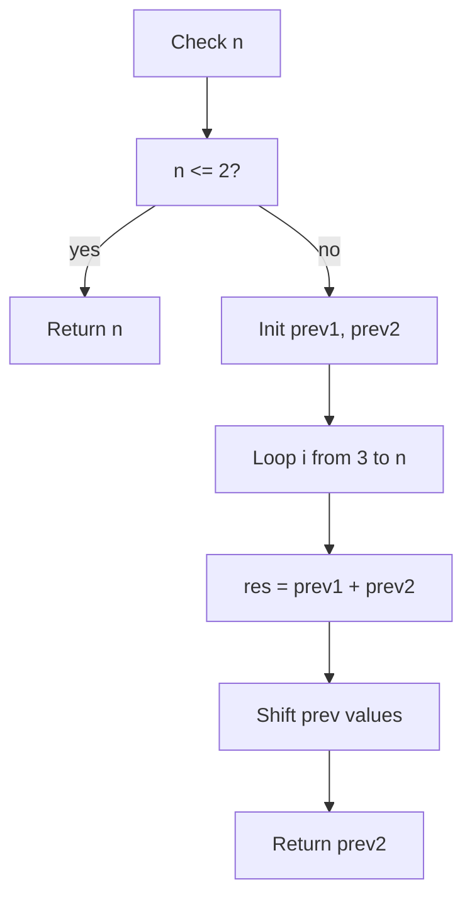

<h2><a href="https://leetcode.com/problems/climbing-stairs">70. Climbing Stairs</a></h2>

<p>You are climbing a staircase. It takes <code>n</code> steps to reach the top.</p>

<p>Each time you can either climb <code>1</code> or <code>2</code> steps. In how many distinct ways can you climb to the top?</p>

<p>&nbsp;</p>
<p><span class="float-right -my-0.5 ml-2 inline-flex select-none items-center" data-example-lang-controls=""><span role="group" class="inline-flex h-6 items-center rounded-sd-md bg-sd-muted p-0.5" data-example-lang-toggle=""><button type="button" aria-pressed="true" class="h-5 max-w-[10rem] truncate whitespace-nowrap rounded-sd-sm border px-2 text-xs font-normal leading-none border-sd-border bg-sd-background text-sd-foreground">Original</button><button type="button" aria-pressed="false" class="h-5 max-w-[10rem] truncate whitespace-nowrap rounded-sd-sm border px-2 text-xs font-normal leading-none border-transparent text-sd-muted-foreground hover:text-sd-foreground">Java</button></span></span><strong class="example">Example 1:</strong></p>

<pre><strong>Input:</strong> n = 2
<strong>Output:</strong> 2
<strong>Explanation:</strong> There are two ways to climb to the top.
1. 1 step + 1 step
2. 2 steps
</pre>

<p><strong class="example">Example 2:</strong></p>

<pre><strong>Input:</strong> n = 3
<strong>Output:</strong> 3
<strong>Explanation:</strong> There are three ways to climb to the top.
1. 1 step + 1 step + 1 step
2. 1 step + 2 steps
3. 2 steps + 1 step
</pre>

<p>&nbsp;</p>
<p><strong>Constraints:</strong></p>

<ul>
	<li><code>1 &lt;= n &lt;= 45</code></li>
</ul>


---

# 🛍️ Climbing-Stairs | Explained

## Approach 1: Iterative DP (Fibonacci)

### Intuition
Each step you take can come from either one step below or two steps below.  
Thus, the number of ways to reach stair `i` equals `ways(i‑1) + ways(i‑2)`, which is exactly the Fibonacci sequence. By iterating once and keeping only the last two counts we obtain the answer in linear time and constant space.

### Algorithm Visualized


### Approach
1. Handle the trivial cases `n = 1` or `n = 2` directly.  
2. Initialise two variables: `prev1` (ways to reach stair 1) and `prev2` (ways to reach stair 2).  
3. Iterate from stair 3 up to `n`, each time computing the current number of ways as the sum of the previous two (`res`).  
4. Slide the window forward: `prev1` becomes the old `prev2`, and `prev2` becomes `res`.  
5. After the loop, `prev2` holds the total ways to reach stair `n`.

### Detailed Code Analysis
The method begins with a guard clause (`if (n <= 2) return n;`) that instantly resolves the smallest inputs, avoiding unnecessary work.  
Two integer variables, `prev1` and `prev2`, are seeded with the base counts for stair 1 and stair 2. These serve as a moving window that represents the last two Fibonacci numbers.  
The `for` loop runs from 3 through `n`. Inside the loop, `res` captures the sum of `prev1` and `prev2`, embodying the recurrence relation. Immediately after, the window slides forward: `prev1` adopts the former `prev2`, and `prev2` adopts `res`. This in‑place update eliminates the need for an array.  
When the loop finishes, `prev2` contains the number of distinct ways to climb `n` stairs, which the method returns.

### Code
```java
class Solution {
    public int climbStairs(int n) {
        if (n <= 2) return n;
        int prev1 = 1;
        int prev2 = 2;
        int res = 0;
        for (int i = 3; i <= n; i++) {
            res = prev1 + prev2;
            prev1 = prev2;
            prev2 = res;
        }
        return prev2;
    }
}
```

### Complexity
- **Time:** `O(n)` – each stair from 3 to `n` is processed exactly once.  
- **Space:** `O(1)` – only a few integer variables are used, independent of `n`.  

## 🕵️‍♂️ Follow-up Questions (Optional)

1. **Can you solve it with O(log n) time?**  
   Yes. The recurrence is linear, so we can use matrix exponentiation or fast doubling to compute the `n`‑th Fibonacci number in `O(log n)` time.

2. **How would you modify the solution for a variable step size set (e.g., you can take 1, 3, 5 steps)?**  
   Generalise the DP: `dp[i] = Σ dp[i - step]` for each allowed `step`. The time becomes `O(n · k)` where `k` is the number of allowed steps, and space can still be reduced to `O(k)` using a sliding window.