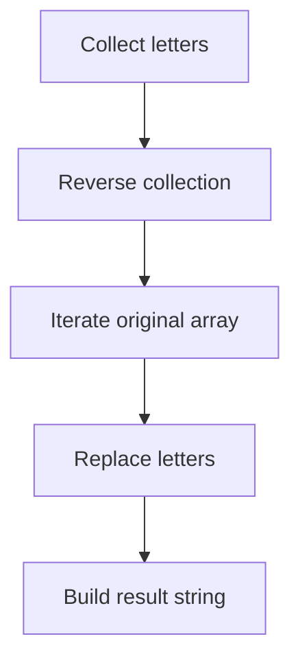

<h2><a href="https://leetcode.com/problems/reverse-only-letters">917. Reverse Only Letters</a></h2>

<p>Given a string <code>s</code>, reverse the string according to the following rules:</p>

<ul>
	<li>All the characters that are not English letters remain in the same position.</li>
	<li>All the English letters (lowercase or uppercase) should be reversed.</li>
</ul>

<p>Return <code>s</code><em> after reversing it</em>.</p>

<p>&nbsp;</p>
<p><span class="float-right -my-0.5 ml-2 inline-flex select-none items-center" data-example-lang-controls=""><span role="group" class="inline-flex h-6 items-center rounded-sd-md bg-sd-muted p-0.5" data-example-lang-toggle=""><button type="button" aria-pressed="true" class="h-5 max-w-[10rem] truncate whitespace-nowrap rounded-sd-sm border px-2 text-xs font-normal leading-none border-sd-border bg-sd-background text-sd-foreground">Original</button><button type="button" aria-pressed="false" class="h-5 max-w-[10rem] truncate whitespace-nowrap rounded-sd-sm border px-2 text-xs font-normal leading-none border-transparent text-sd-muted-foreground hover:text-sd-foreground">Java</button></span></span><strong class="example">Example 1:</strong></p>
<pre><strong>Input:</strong> s = "ab-cd"
<strong>Output:</strong> "dc-ba"
</pre><p><strong class="example">Example 2:</strong></p>
<pre><strong>Input:</strong> s = "a-bC-dEf-ghIj"
<strong>Output:</strong> "j-Ih-gfE-dCba"
</pre><p><strong class="example">Example 3:</strong></p>
<pre><strong>Input:</strong> s = "Test1ng-Leet=code-Q!"
<strong>Output:</strong> "Qedo1ct-eeLg=ntse-T!"
</pre>
<p>&nbsp;</p>
<p><strong>Constraints:</strong></p>

<ul>
	<li><code>1 &lt;= s.length &lt;= 100</code></li>
	<li><code>s</code> consists of characters with ASCII values in the range <code>[33, 122]</code>.</li>
	<li><code>s</code> does not contain <code>'\"'</code> or <code>'\\'</code>.</li>
</ul>


---

# 🛍️ Reverse-Only-Letters | Explained

## Approach 1: Two‑Pass Letter Collection
### Intuition
Think of the string as a line of mixed objects where only the letters are “special” items that need to be reversed. First we gather all special items, flip their order, then walk the line again and replace each special item with the next one from the reversed collection. Non‑letters stay untouched, just like placeholders on a conveyor belt.

### Algorithm Visualized


### Approach
1. Convert the input string to a mutable `char[]`.
2. Scan once, appending every alphabetic character to a `StringBuilder`.
3. Reverse the `StringBuilder` so the letters are in the desired order.
4. Scan the `char[]` a second time; whenever a letter is encountered, replace it with the next character from the reversed `StringBuilder`.
5. Convert the modified `char[]` back to a `String` and return it.

### Detailed Code Analysis
- **Preparation:** `char[] ch = s.toCharArray();` creates a mutable copy of the input. A `StringBuilder letters` is allocated to store only the alphabetic characters.
- **First Pass (Collect):** The `for (char c : ch)` loop checks each character with `Character.isLetter(c)`. Letters are appended to `letters`; non‑letters are ignored, preserving their original positions for later.
- **Reversal:** `letters.reverse();` flips the order of the collected letters in‑place, giving us the exact sequence needed for the final string.
- **Second Pass (Replace):** An index variable tracks the position inside the reversed `letters`. The `for (int i = 0; i < ch.length; i++)` loop walks the original array; when it sees a letter, it substitutes `ch[i]` with `letters.charAt(index++)`. This step respects the original non‑letter positions.
- **Result Construction:** `new String(ch)` builds the final string from the mutated character array, which now contains the reversed letters and original non‑letters.

### Code
```java
class Solution {
    public String reverseOnlyLetters(String s) {
        char[] ch = s.toCharArray();
        StringBuilder letters = new StringBuilder();

        // Store all letters
        for (char c : ch) {
            if (Character.isLetter(c)) {
                letters.append(c);
            }
        }

        // Reverse the letters
        letters.reverse();

        // Put reversed letters back
        int index = 0;
        for (int i = 0; i < ch.length; i++) {
            if (Character.isLetter(ch[i])) {
                ch[i] = letters.charAt(index++);
            }
        }

        return new String(ch);
    }
}
```

### Complexity
- **Time:** `O(n)` – two linear scans over the string (collect & replace) plus an `O(m)` reversal where `m ≤ n`. Overall linear in the length of `s`.
- **Space:** `O(m)` extra space for the `StringBuilder` holding the letters, where `m` is the number of alphabetic characters (worst‑case `O(n)`).

## 🕵️‍♂️ Follow-up Questions (Optional)

1. **Can you solve it in‑place with O(1) extra space?**  
   Yes. Use two pointers, one from the start and one from the end, swapping letters when both pointers land on alphabetic characters and skipping non‑letters otherwise.

2. **How would you adapt the solution for Unicode letters beyond ASCII?**  
   Replace `Character.isLetter` with a Unicode‑aware check (it already handles Unicode) and ensure the `char[]` representation accounts for surrogate pairs, possibly processing the string as an `int[]` of code points.